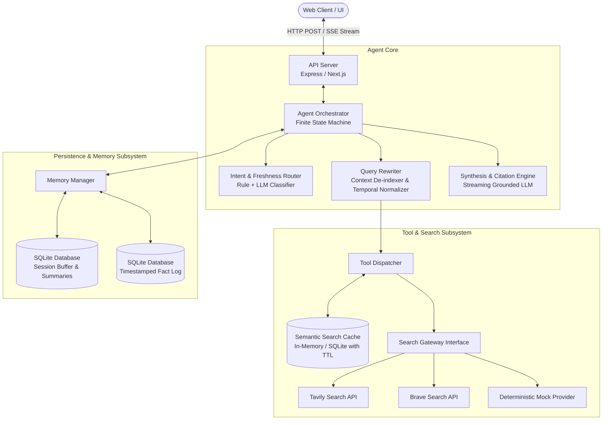
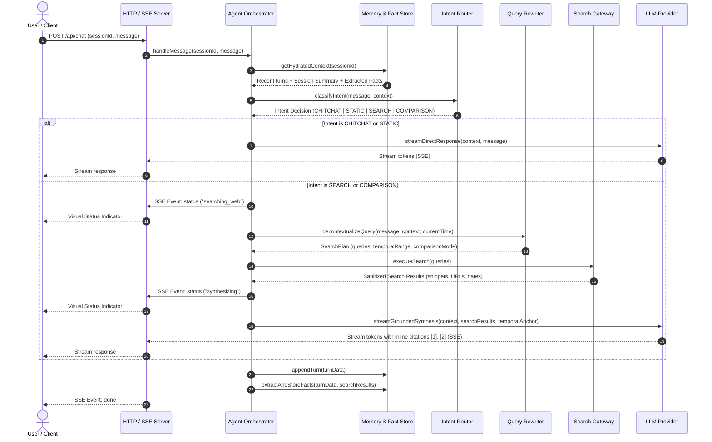
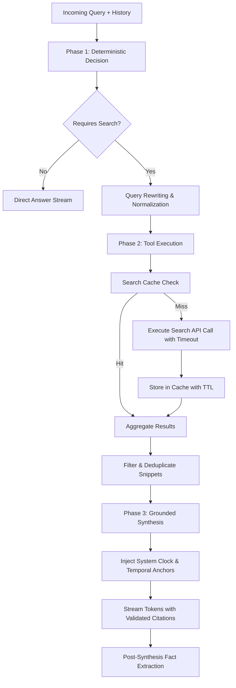
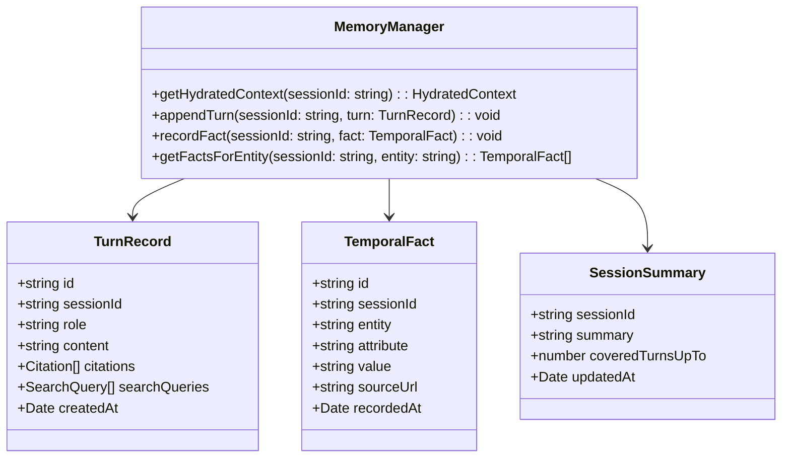

# System Architecture

## 1. System Overview

`minimi-ai-chat-agent` is an intelligent conversational agent engineered for high-accuracy, date-aware reasoning, and source-grounded answers with real-time web search as its sole external capability.

The system is designed around four core tenets:
1. **Low Latency & High Signal**: Zero-overhead responses for conversational turns; targeted, de-contextualized web searches only when factual or temporal freshness demands it.
2. **Deterministic Temporal Grounding**: Strict system-clock anchoring and an indexed Temporal Fact Log to eliminate hallucinations on historical dates, price fluctuations, and evolving events.
3. **Transparent Source Attribution**: Strict citation-anchored output mapping assertions directly to verified web payloads.
4. **Production Resilience**: Multi-layered fault tolerance (circuit breakers, exponential backoff with jitter, semantic caching, and graceful fallbacks).

---

## 2. Architecture Diagram



---

## 3. Component Responsibilities

| Component | Module | Responsibilities |
| :--- | :--- | :--- |
| **API Server / SSE Endpoint** | `src/server/` | Accepts incoming chat requests, manages SSE connections, validates payloads via Zod, handles CORS and error formatting. |
| **Agent Orchestrator** | `src/core/agent.ts` | Implements the deterministic state machine governing message progression: hydration, classification, tool execution, and synthesis. |
| **Intent Router** | `src/core/router/intentRouter.ts` | Classifies queries (Chitchat, Static Knowledge, Real-Time Search, Temporal Comparison) to prevent unnecessary search tool invocations. |
| **Query Rewriter** | `src/core/router/queryRewriter.ts` | Resolves conversational pronouns and references; normalizes relative temporal expressions (e.g., "yesterday" $\rightarrow$ absolute calendar date). |
| **Tool Dispatcher & Gateway** | `src/core/tools/` | Decouples search execution from providers through `SearchProvider` interface; handles timeouts, caching, and result sanitization. |
| **Memory Manager** | `src/core/memory/memoryManager.ts` | Coordinates short-term rolling context windows, session summarization, and retrieval of prior historical assertions. |
| **Temporal Fact Store** | `src/core/memory/sqliteStore.ts` | Persists structured `(Entity, Attribute, Value, Timestamp, Source)` tuples for chronological comparison across turns. |
| **Synthesis & Citation Engine**| `src/core/synthesis/` | Injects system temporal anchors, builds grounded prompts, enforces source URL citations `[N]`, and formats temporal diff tables. |
| **Resilience Layer** | `src/core/resilience/` | Provides retry loops with exponential backoff and full jitter, circuit breakers, and token bucket rate limiters. |

---

## 4. Request-Response Lifecycle



---

## 5. LLM and Web-Search Tool-Calling Workflow

Rather than employing an unpredictable, multi-turn autonomous ReAct loop that risks latency bloat and runaway token consumption, the agent follows a **Deterministic Two-Phase Tool-Calling Flow**:



### 5.1 Intent Routing Heuristics
1. **Chitchat & Greetings**: `"hello"`, `"who are you"`, `"thanks"`, `"good morning"` $\rightarrow$ Direct LLM path (latency $< 500\text{ ms}$).
2. **Static Knowledge**: Math operations, code writing, theoretical concepts without temporal dependencies $\rightarrow$ Direct LLM path.
3. **Conversational Recall**: Queries strictly referencing prior in-session discussion without asking for current status $\rightarrow$ Direct LLM path leveraging session history.
4. **Real-Time & Volatile**: Inquires regarding current prices, software releases, today's news, current stock levels, weather, or events occurring after the model's training cutoff $\rightarrow$ Web Search path.
5. **Temporal Comparison**: Queries challenging past answers or contrasting two distinct time periods $\rightarrow$ Web Search path + Historical Fact retrieval.

### 5.2 Query Formulation & Decontextualization
When search is required, the raw user query is rewritten to be standalone and unambiguous:
- **Pronoun Resolution**: *"How much does it cost?"* following an iPhone 16 discussion becomes `"iPhone 16 retail price 2026"`.
- **Temporal Normalization**: Relative terms like *"yesterday"*, *"last quarter"*, or *"current"* are transformed into exact calendar dates or month-year ranges based on the system anchor date.
- **Search Query Budget**: The rewriter produces a maximum of 2 focused search queries executed in parallel via `Promise.allSettled`.

---

## 6. Conversation Memory Design

Conversational continuity and historical comparison require a multi-tiered memory architecture:



### 6.1 Memory Tiers
1. **Sliding Working Window (Short-Term)**:
   - Preserves the last $K$ turns (default: 6 turns / ~2,000 tokens) verbatim to ensure immediate conversational cadence and tone.
2. **Hierarchical Session Summarizer (Mid-Term)**:
   - When a conversation exceeds $K$ turns, older turns are summarized into a concise narrative stored in SQLite. This summary is injected into subsequent prompts without bloating token budgets.
3. **Temporal Fact Log (Long-Term Structured Memory)**:
   - Every time web search results are synthesized, factual assertions are extracted into structured records:
     - `entity`: Subject (e.g., `"Tesla Model 3 Base"`).
     - `attribute`: Metric or property (e.g., `"US Starting Price"`).
     - `value`: Factual claim (e.g., `"$38,990"`).
     - `sourceUrl`: Verified origin URL.
     - `recordedAt`: Exact timestamp of observation.

---

## 7. Historical Information & Temporal Retrieval

Handling questions involving changing prices, superseded facts, or historical dates requires deterministic date grounding:

### 7.1 Temporal Anchor Injection
Every prompt sent to the LLM begins with an immutable system clock header:
```text
[SYSTEM TIME CONTEXT]
Current Date: 2026-11-11
Current Time: 07:41:18 UTC
Day of Week: Wednesday
Current Year: 2026
Instruction: All temporal assertions ("now", "recent", "today", "last year") must be calculated relative to 2026-11-11.
```

### 7.2 Historical & Comparative Query Resolution
When a user asks:
> *"You said earlier that Figma was \$12/mo. Has that changed recently?"*

The retrieval engine executes:
1. **Fact Lookup**: The `TemporalFactStore` retrieves the previous claim: `Figma | Pricing | $12/month | 2026-09-15 | URL`.
2. **Targeted Fresh Search**: The agent issues a query: `"Figma professional subscription pricing November 2026"`.
3. **Temporal Diff Synthesis**:
   - The synthesizer receives both the historical assertion and the fresh web snippets.
   - It outputs an explicit chronological comparison table:
     - **Previous Observation**: \$12.00/mo (observed Sept 15, 2026).
     - **Current Observation**: \$15.00/mo (observed Nov 11, 2026).
     - **Delta / Summary**: Price increased by \$3.00/mo (+25%).

---

## 8. Security Considerations

1. **Zero Secret Leakage**:
   - All API keys (`OPENAI_API_KEY`, `TAVILY_API_KEY`, etc.) reside strictly in server-side `.env`.
   - Client applications communicate exclusively via the `/api/chat` backend proxy; no API keys or upstream tokens are ever bundled or returned in response headers.
2. **Citation Domain Whitelisting**:
   - The agent strictly validates inline citations `[N]` against the exact URLs returned by the search gateway. The synthesizer cannot emit arbitrary or hallucinated hyperlinks.
3. **Prompt Injection & Query Sanitization**:
   - Web snippet contents are treated as untrusted data. They are wrapped in explicit XML-style containment blocks (`<search_results>...</search_results>`) with instructions preventing the LLM from executing instructions contained within web pages.
4. **Input Length & Rate Limiting**:
   - Incoming user requests are bounded at 2,000 characters to prevent prompt bloat or Denial-of-Service attacks.
   - In-memory token bucket rate limiters prevent abuse per IP or session ID.
5. **No Dangerous System Execution**:
   - The agent has no shell, file execution, or internal network access. Web search is its sole external I/O capability.
