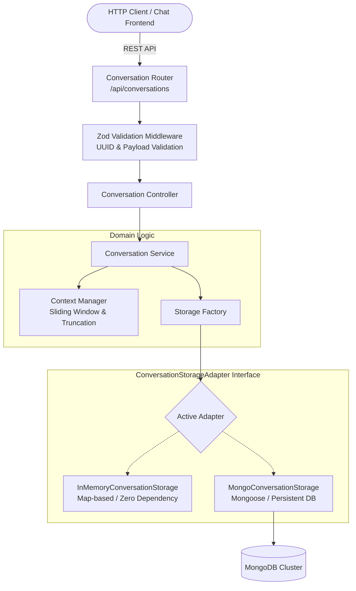
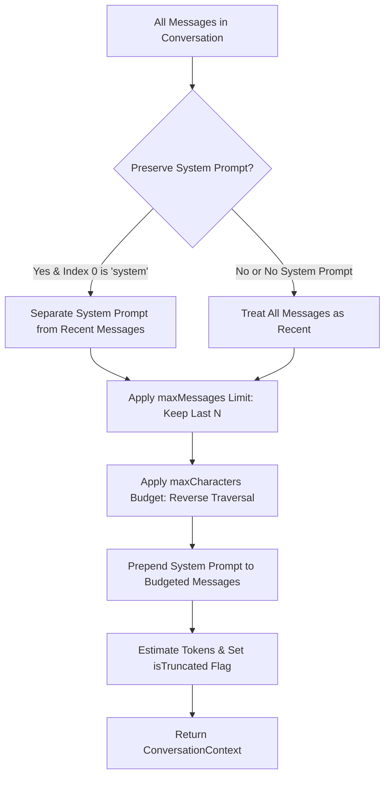

# Conversation Memory Architecture (Phase 4)

## 1. Overview

The Conversation Memory subsystem provides the persistent and in-session memory foundation for `minimi-ai-chat-agent`. It decouples conversation management and message history from agent reasoning and search capabilities, ensuring:

1. **Pluggable Storage Abstraction**: A unified `ConversationStorageAdapter` interface allows seamless switching between an in-memory repository (for testing, local evaluation, or lightweight setups) and a persistent database repository (MongoDB via Mongoose).
2. **Deterministic Context Management**: The `ContextManager` applies sliding window heuristics, character/token budgets, and system prompt preservation to prepare conversation history for downstream LLM reasoning without context window overflows.
3. **Strict Validation & Isolation**: Robust UUID v4 validation, message role constraints, character limits, and relational integrity ensure conversations cannot cross-contaminate and invalid payloads are rejected at the edge.
4. **Rich Metadata & Grounding**: Messages support arbitrary metadata—such as citations from web search results, token counts, or execution latencies—enabling date-aware historical comparison and source traceability.

---

## 2. Architectural Design



### 2.1 Component Responsibilities

| Component | Responsibility |
| :--- | :--- |
| `src/routes/conversationRoute.ts` | Declares REST routes and applies Zod parameter, query, and body validation schemas. |
| `src/controllers/conversationController.ts` | Handles HTTP transport, maps inputs to service methods, and wraps outputs in standard `ApiResponse` envelopes. |
| `src/services/memory/conversationService.ts` | Core domain service managing conversation lifecycle, message appending, validation, and context extraction. |
| `src/services/memory/contextManager.ts` | Calculates sliding context windows, applies message count and character/token budgets, preserves system prompts, and flags truncation. |
| `src/services/memory/storageFactory.ts` | Instantiates and initializes the configured storage adapter, providing automated fallback to in-memory storage if MongoDB is unavailable. |
| `src/services/memory/adapters/` | Implementations of `ConversationStorageAdapter`: `inMemoryAdapter.ts` and `mongoAdapter.ts`. |

---

## 3. Data Models

### 3.1 Domain Types (`src/types/index.ts`)

```typescript
export type MessageRole = 'user' | 'assistant' | 'system';

export interface MessageMetadata {
  sources?: SearchResult[];
  tokens?: number;
  query?: string;
  [key: string]: unknown;
}

export interface ConversationMessage {
  id: string;
  conversationId: string;
  role: MessageRole;
  content: string;
  metadata?: MessageMetadata;
  createdAt: string;
}

export interface Conversation {
  id: string;
  title: string;
  metadata?: Record<string, unknown>;
  createdAt: string;
  updatedAt: string;
  messageCount: number;
}

export interface ContextWindowOptions {
  maxMessages?: number;
  maxCharacters?: number;
  preserveSystemPrompt?: boolean;
}

export interface ConversationContext {
  conversationId: string;
  messages: ConversationMessage[];
  totalMessages: number;
  includedMessages: number;
  isTruncated: boolean;
  estimatedTokens: number;
}
```

---

## 4. Sliding Context Window Workflow

When preparing conversation history for LLM prompting, passing an unbounded message history risks exceeding model context limits and inflating API latency. The `ContextManager` uses a deterministic sliding window algorithm:



### Context Budgeting Rules:
1. **System Prompt Anchoring**: If `preserveSystemPrompt: true` and the first message is a `system` prompt, it is always anchored at index 0 and exempt from sliding cutoff.
2. **Chronological Recency**: The most recent user and assistant interactions are given priority over older turns.
3. **Character & Token Caps**: Once the cumulative character limit is reached during reverse traversal, older messages are omitted.
4. **Truncation Transparency**: The resulting context returns `isTruncated: true` when any historical messages were excluded, along with `totalMessages` vs `includedMessages`.

---

## 5. Storage Strategy & Provider Factory

### 5.1 Storage Adapter Interface (`src/services/memory/types.ts`)

```typescript
export interface ConversationStorageAdapter {
  readonly name: string;
  initialize(): Promise<void>;
  close(): Promise<void>;
  createConversation(title?: string, metadata?: Record<string, unknown>): Promise<Conversation>;
  getConversation(id: string): Promise<Conversation | null>;
  listConversations(page?: number, limit?: number): Promise<{ conversations: Conversation[]; total: number }>;
  deleteConversation(id: string): Promise<boolean>;
  addMessage(message: Omit<ConversationMessage, 'id' | 'createdAt'>): Promise<ConversationMessage>;
  getMessages(conversationId: string, limit?: number, before?: string): Promise<ConversationMessage[]>;
  getMessageCount(conversationId: string): Promise<number>;
}
```

### 5.2 Storage Adapters

1. **`InMemoryConversationStorage`**:
   - Stores conversations and messages in memory using synchronized `Map` structures.
   - Guarantees millisecond latency and zero operational dependencies.
   - Ideal for unit testing, CI/CD pipelines, and local development.
   
2. **`MongoConversationStorage`**:
   - Persists data to MongoDB collections (`conversations` and `messages`) via Mongoose.
   - Indexes `conversationId` and `createdAt` for high-performance timeline queries.
   - Automatically handles connection lifecycle and graceful shutdowns.

3. **Storage Factory Fallback**:
   - Configured via `STORAGE_PROVIDER=memory|mongodb`.
   - If `STORAGE_PROVIDER=mongodb` is specified but `MONGODB_URI` is missing or the database connection times out, the factory logs a warning and falls back to `InMemoryConversationStorage` to prevent server crashes.

---

## 6. REST API Reference

### 6.1 Create Conversation
* **Endpoint**: `POST /api/conversations`
* **Request Body**:
```json
{
  "title": "Cloud Architecture Inquiry",
  "metadata": { "client": "web-ui" }
}
```
* **Response (201 Created)**:
```json
{
  "success": true,
  "data": {
    "id": "e8a946cf-305d-4f1e-bca2-8db48ee37119",
    "title": "Cloud Architecture Inquiry",
    "metadata": { "client": "web-ui" },
    "createdAt": "2026-11-13T19:30:00.000Z",
    "updatedAt": "2026-11-13T19:30:00.000Z",
    "messageCount": 0
  }
}
```

---

### 6.2 List Conversations
* **Endpoint**: `GET /api/conversations?page=1&limit=20`
* **Response (200 OK)**:
```json
{
  "success": true,
  "data": {
    "conversations": [
      {
        "id": "e8a946cf-305d-4f1e-bca2-8db48ee37119",
        "title": "Cloud Architecture Inquiry",
        "createdAt": "2026-11-13T19:30:00.000Z",
        "updatedAt": "2026-11-13T19:30:00.000Z",
        "messageCount": 0
      }
    ],
    "pagination": {
      "page": 1,
      "limit": 20,
      "total": 1,
      "totalPages": 1
    }
  }
}
```

---

### 6.3 Get Conversation by ID
* **Endpoint**: `GET /api/conversations/:id`
* **Response (200 OK)**:
```json
{
  "success": true,
  "data": {
    "id": "e8a946cf-305d-4f1e-bca2-8db48ee37119",
    "title": "Cloud Architecture Inquiry",
    "createdAt": "2026-11-13T19:30:00.000Z",
    "updatedAt": "2026-11-13T19:30:00.000Z",
    "messageCount": 2
  }
}
```

---

### 6.4 Append Message to Conversation
* **Endpoint**: `POST /api/conversations/:id/messages`
* **Request Body**:
```json
{
  "role": "user",
  "content": "What is the latest LTS version of Node.js?",
  "metadata": { "clientTimestamp": "2026-11-13T19:31:00.000Z" }
}
```
* **Response (201 Created)**:
```json
{
  "success": true,
  "data": {
    "id": "c1611a91-4475-430c-ab59-ec58fb5642a4",
    "conversationId": "e8a946cf-305d-4f1e-bca2-8db48ee37119",
    "role": "user",
    "content": "What is the latest LTS version of Node.js?",
    "metadata": { "clientTimestamp": "2026-11-13T19:31:00.000Z" },
    "createdAt": "2026-11-13T19:31:00.100Z"
  }
}
```

---

### 6.5 Get Messages / Context Window
* **Endpoint**: `GET /api/conversations/:id/messages?maxMessages=10&maxCharacters=4000&preserveSystemPrompt=true`
* **Response (200 OK)**:
```json
{
  "success": true,
  "data": {
    "conversationId": "e8a946cf-305d-4f1e-bca2-8db48ee37119",
    "messages": [
      {
        "id": "c1611a91-4475-430c-ab59-ec58fb5642a4",
        "conversationId": "e8a946cf-305d-4f1e-bca2-8db48ee37119",
        "role": "user",
        "content": "What is the latest LTS version of Node.js?",
        "createdAt": "2026-11-13T19:31:00.100Z"
      }
    ],
    "totalMessages": 1,
    "includedMessages": 1,
    "isTruncated": false,
    "estimatedTokens": 11
  }
}
```

---

### 6.6 Delete Conversation
* **Endpoint**: `DELETE /api/conversations/:id`
* **Response (200 OK)**:
```json
{
  "success": true,
  "data": {
    "message": "Conversation deleted successfully."
  }
}
```

---

## 7. Security and Integrity

1. **Strict UUID v4 Validation**: All path parameters (`:id`) and query parameters (`before`) are validated against RFC 4122 UUID specifications, preventing SQL/NoSQL injection and path traversal attempts.
2. **Input Sanitization**: Content length is enforced at the controller level (`MAX_MESSAGE_LENGTH`, default 32,000 characters). Blank strings and invalid roles are rejected immediately with HTTP 400.
3. **Conversation Isolation**: Messages are bound strictly to their parent `conversationId`. Adding a message to a non-existent conversation returns HTTP 404 rather than creating orphaned records.
4. **Zero Secret Leakage**: Database credentials in `MONGODB_URI` remain encapsulated in server-side configuration and are never echoed in logs or API errors.

---

## 8. Current Limitations & Future Roadmap

- **LLM Decoupling**: Phase 4 focuses entirely on memory storage and context retrieval. Agent reasoning and LLM tool calling will be introduced in Phase 5.
- **Token Estimation**: Tokens are currently calculated using the industry standard heuristic (`Math.ceil(chars / 4)`). Phase 5 can optionally bind exact BPE tokenizers (such as `tiktoken`) without changing the `ConversationContext` contract.
- **Context Summarization**: The `ContextSummarizer` interface is defined in `src/services/memory/types.ts` for future automated history compaction when conversations exceed large turn counts.
