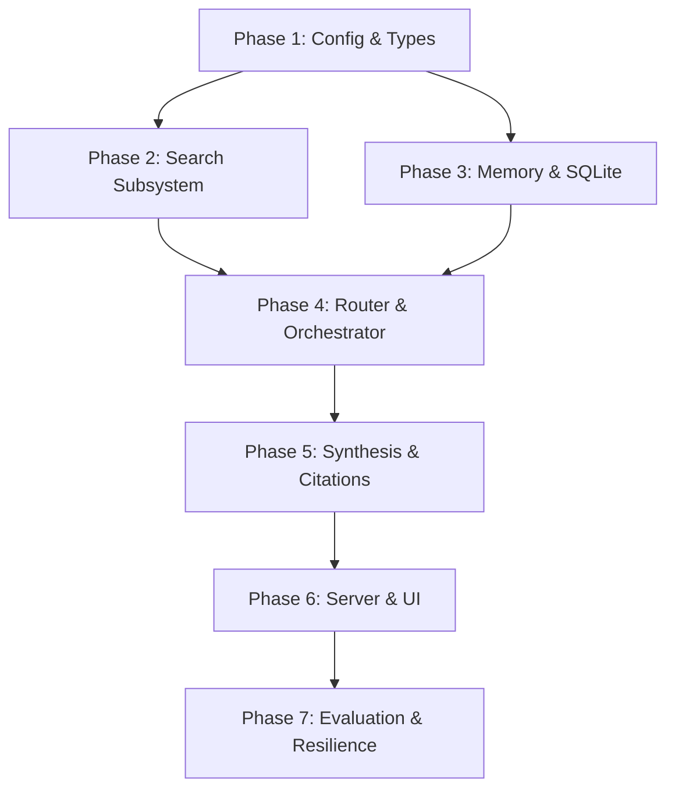

# Implementation Plan & Engineering Roadmap

## 1. Overview & Strategy

This document outlines the step-by-step implementation plan for the `minimi-ai-chat-agent`. Development is divided into **7 independent, verifiable phases** following test-driven and modular architectural principles.

Each phase is self-contained, specifies explicit deliverables, lists component dependencies, and provides an unambiguous **Definition of Done (DoD)**.

---

## 2. Phase-by-Phase Roadmap

### Phase 1: Project Scaffolding, Configuration & Core Domain Contracts

#### Objectives
Establish the repository structure, strict TypeScript build tooling, Zod-based environment validation, and core domain data models.

#### Tasks
- Initialize `package.json` with standard build scripts (`dev`, `build`, `start`, `test`, `test:eval`).
- Configure `tsconfig.json` in strict mode (`noImplicitAny`, `strictNullChecks`).
- Create `.env.example` documenting all configuration keys (`LLM_API_KEY`, `SEARCH_API_KEY`, `PORT`, `CACHE_TTL_MS`, `SESSION_DB_PATH`).
- Implement `src/config/env.ts` with Zod schema validation to fail-fast at boot if required keys are missing or malformed.
- Define core domain TypeScript interfaces in `src/core/types.ts`:
  - `ChatMessage` (`id`, `role`, `content`, `timestamp`)
  - `Citation` (`id`, `index`, `title`, `url`, `snippet`, `publishedDate`)
  - `SearchPlan` (`shouldSearch`, `queries`, `temporalRange`, `comparisonMode`, `reasoning`)
  - `TemporalFact` (`id`, `sessionId`, `entity`, `attribute`, `value`, `sourceUrl`, `recordedAt`)
  - `AgentStreamEvent` (SSE union types for streaming tokens, status updates, and citations).

#### Dependencies
None (Root phase).

#### Definition of Done (DoD)
- [ ] `npm run build` compiles with zero TypeScript errors.
- [ ] Server boot script throws a clear, typed error if `.env` is absent or missing mandatory variables.
- [ ] All domain interfaces are documented with typed docstrings and exported from `src/core/types.ts`.

---

### Phase 2: Web Search Subsystem, Caching & Mock Providers

#### Objectives
Build an isolated, testable web-search abstraction layer with timeout enforcement, semantic caching, and deterministic offline mocking.

#### Tasks
- Define the `SearchProvider` interface in `src/core/tools/searchProvider.ts`.
- Implement `TavilySearchProvider` in `src/core/tools/tavilyProvider.ts`:
  - Timeout protection via `AbortController` (default: 4,000 ms).
  - Normalization of search results into uniform `SearchResultItem` payloads.
  - Snippet truncation to prevent token context bloat.
- Implement `MockSearchProvider` in `src/core/tools/mockProvider.ts`:
  - Returns predefined, deterministic search results for automated unit tests and offline evaluation.
- Implement `SearchCache` in `src/core/resilience/searchCache.ts`:
  - In-memory or SQLite key-value store with TTL (Time-To-Live).
  - Query canonicalization (lowercase, whitespace trimming, stop-word normalization).
- Implement exponential backoff retry utility in `src/core/resilience/retry.ts`.

#### Dependencies
- Phase 1 (Core types and validated environment).

#### Definition of Done (DoD)
- [ ] `MockSearchProvider` allows 100% offline testing of search handling.
- [ ] Unit tests pass for timeout handling, cache hit/miss behavior, and backoff retries.
- [ ] Live search queries cleanly normalize raw API responses to typed `SearchResultItem[]`.

---

### Phase 3: Conversational Memory & Temporal Fact Store

#### Objectives
Implement embedded SQLite persistence for multi-turn sessions, rolling context windows, and structured temporal fact logging.

#### Tasks
- Initialize SQLite schema via `better-sqlite3` in `src/core/memory/sqliteStore.ts`:
  - Table `sessions`: Session metadata, creation time, last active time.
  - Table `messages`: Raw conversational turns, role, content, citations JSON, timestamps.
  - Table `temporal_facts`: Structured entity-attribute-value tuples with source URLs and observation timestamps.
  - Table `session_summaries`: Compressed text summaries of older turns.
- Implement `MemoryManager` in `src/core/memory/memoryManager.ts`:
  - `getHydratedContext(sessionId)`: Retrieves recent turns and session summary.
  - `appendTurn(sessionId, turn)`: Persists user/assistant messages.
  - `recordFact(sessionId, fact)`: Records extracted factual claims.
  - `getHistoricalFacts(sessionId, entity)`: Queries past factual claims for an entity to enable comparison.
- Implement `ContextCompressor` in `src/core/memory/contextCompressor.ts`:
  - Truncates conversation turns exceeding token limits while generating a running summary.

#### Dependencies
- Phase 1 (Domain types).

#### Definition of Done (DoD)
- [ ] Database tables and indexes are automatically created if they do not exist.
- [ ] Multi-turn messages persist across application restarts.
- [ ] Unit tests verify that historical facts can be written, indexed, and retrieved by entity name.

---

### Phase 4: Intent Router, Query Rewriter & Agent State Machine

#### Objectives
Build the decision-making intelligence: classify user intent, decontextualize follow-up questions, normalize relative dates, and orchestrate agent transitions.

#### Tasks
- Implement `IntentRouter` in `src/core/router/intentRouter.ts`:
  - Evaluates whether a query is `CHITCHAT`, `STATIC_KNOWLEDGE`, `CONVERSATION_REFERENCE`, `REALTIME_SEARCH`, or `TEMPORAL_COMPARISON`.
  - Implements fast-path heuristics for greetings and timeless logic queries.
- Implement `QueryRewriter` in `src/core/router/queryRewriter.ts`:
  - Injects current system date (`YYYY-MM-DD`).
  - Rewrites ambiguous pronouns based on previous session messages.
  - Converts relative date terms ("yesterday", "last year", "3 months ago") into concrete Gregorian calendar dates.
- Implement `AgentOrchestrator` in `src/core/agent.ts`:
  - Implements the main state machine coordinating Context Loading $\rightarrow$ Intent Routing $\rightarrow$ Query Rewriting $\rightarrow$ Tool Dispatch $\rightarrow$ Synthesis $\rightarrow$ Memory Persistence.

#### Dependencies
- Phase 1 (Types)
- Phase 2 (Search tools)
- Phase 3 (Memory management)

#### Definition of Done (DoD)
- [ ] Greeting queries bypass web search completely and answer directly in $< 500\text{ ms}$.
- [ ] Follow-up questions with pronouns (e.g. "How much is it?") correctly incorporate context from prior turns.
- [ ] Relative time queries ("Who won the game yesterday?") correctly produce date-anchored search queries.

---

### Phase 5: Synthesis Engine, Citation Validation & Temporal Diff Formatter

#### Objectives
Ensure all factual responses are strictly grounded in web results with verified inline citations and structured chronological comparisons.

#### Tasks
- Implement `PromptBuilder` in `src/core/synthesis/promptBuilder.ts`:
  - Assembles system prompt with immutable system clock anchor.
  - Formats retrieved search snippets into sanitized XML boundaries (`<search_results>`).
- Implement `CitationTracker` in `src/core/synthesis/citationTracker.ts`:
  - Enforces `[1]`, `[2]` citation format in LLM output.
  - Validates citation indexes against the actual search payload URLs, stripping any hallucinated references.
  - Formats the Sources bibliography footer with domain names and publication dates.
- Implement `DiffSynthesizer` in `src/core/synthesis/diffSynthesizer.ts`:
  - When in `TEMPORAL_COMPARISON` mode, prompts the LLM to output a structured markdown comparison (Baseline Date & Value vs Current Date & Value vs Delta).

#### Dependencies
- Phase 4 (Agent orchestrator and routed context).

#### Definition of Done (DoD)
- [ ] 100% of generated citations match actual search URLs returned by the search provider.
- [ ] Responses handling price changes display an explicit before-and-after comparison.
- [ ] Conflicting source information is highlighted rather than masked.

---

### Phase 6: API Server, SSE Streaming & Interactive Web Client

#### Objectives
Expose the agent via an HTTP/SSE server and provide a clean, responsive web interface.

#### Tasks
- Implement HTTP Server in `src/server/server.ts`:
  - Route `POST /api/chat`: Accepts `{ sessionId, message }` and streams Server-Sent Events (`event: status`, `event: token`, `event: citation`, `event: done`).
  - Route `GET /api/sessions`: Returns list of past sessions.
  - Route `GET /api/sessions/:id`: Returns full message history for a session.
  - Route `DELETE /api/sessions/:id`: Clears session history.
- Implement Interactive UI in `src/client/`:
  - Streaming markdown renderer with code block syntax highlighting.
  - Interactive Citation Pills: Clicking `[1]` scrolls to or displays the source URL and domain.
  - Real-time agent status indicators (`"Thinking"`, `"Searching Web"`, `"Comparing Timestamps"`).
  - Session sidebar allowing creating, switching, and deleting chat conversations.

#### Dependencies
- Phase 5 (Synthesis and streaming core).

#### Definition of Done (DoD)
- [ ] `npm run dev` starts the application on a single local port.
- [ ] Full end-to-end conversational interaction works with live streaming tokens.
- [ ] Citations and temporal diff badges render accurately in the chat UI.

---

### Phase 7: Evaluation Framework, Resilience Testing & Documentation

#### Objectives
Verify correctness, benchmark latency, execute test suite EV-01 to EV-06, and provide production-ready documentation.

#### Tasks
- Implement automated evaluation runner in `tests/eval/evalRunner.ts`:
  - **EV-01 (Zero-Search Efficiency)**: Verifies 0 search calls on code/math queries.
  - **EV-02 (Volatile/Real-Time Data)**: Verifies real-time fact retrieval and citation presence.
  - **EV-03 (Date-Aware Historical)**: Verifies correct answers for specific past years.
  - **EV-04 (Conversational Follow-Up)**: Tests pronoun resolution across a 2-turn dialogue.
  - **EV-05 (Temporal Price Comparison)**: Tests comparison between past stored price and current search.
  - **EV-06 (Conflicting Information)**: Tests handling of disputed or missing web claims.
- Add circuit breaker and rate limiting middleware to the API server.
- Document setup, configuration, and API specifications in `README.md`.

#### Dependencies
- Phases 1 through 6.

#### Definition of Done (DoD)
- [ ] `npm test` runs all unit and integration tests cleanly.
- [ ] `npm run test:eval` executes the evaluation benchmark and outputs a summary report.
- [ ] Zero API keys or secrets are exposed in client builds or git tracking.

---

## 3. Component Dependency Graph

---

## 4. Testing Strategy Matrix

| Test Level | Scope | Tools | Execution Target |
| :--- | :--- | :--- | :--- |
| **Unit Tests** | Router rules, date normalizer, query rewriter, citation validator, retry backoff | Node test runner / Vitest | `npm test` ($< 5\text{s}$) |
| **Integration Tests** | SQLite session persistence, cache TTL expiration, search provider fallbacks | Node test runner / SQLite in-memory | `npm test` ($< 10\text{s}$) |
| **Evaluation Suite** | End-to-end agent behavior on EV-01 to EV-06 scenarios | `tests/eval/evalRunner.ts` with Mock & Live providers | `npm run test:eval` |
| **Security Audit** | Verification of `.env` exclusion, CORS configuration, sanitized search inputs | Automated script check | Pre-commit / CI |
