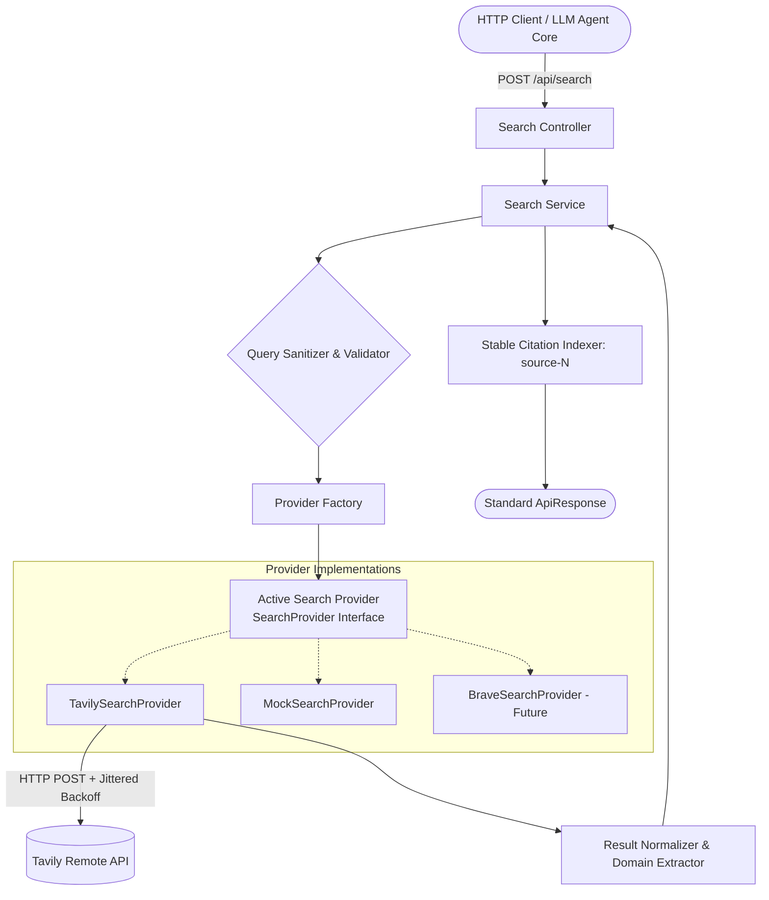

# Web Search Integration Architecture (Phase 3)

## 1. Overview

The web search subsystem serves as the **exclusive external information-gathering tool** for the `minimi-ai-chat-agent`. It is architected for:

1. **Provider Agnosticism**: Pluggable provider interface (`SearchProvider`) enabling easy replacement or fallbacks (Tavily, Brave, Mock).
2. **Deterministic Citation Foundation**: Guarantees stable source identifiers (`id: "source-1"`, `index: 1`), original URLs, and extracted source domains. Never fabricates missing metadata.
3. **Resilience & Fault Tolerance**: Request timeouts via `AbortController`, exponential backoff with full jitter for transient 429/5xx errors, and early-exit bailouts for 400/401/403.
4. **Zero Secret Leakage**: Search API keys reside strictly on the server-side and are validated at runtime.

---

## 2. Search Provider Architecture



### 2.1 The `SearchProvider` Interface

All search providers implement the standard interface defined in `src/services/search/types.ts`:

```typescript
export interface SearchProvider {
  readonly name: string;
  search(query: string, options?: SearchOptions): Promise<RawSearchResponse>;
}
```

---

## 3. Environment Configuration

The following variables in `.env` govern the web search subsystem:

| Variable | Type | Default | Description |
| :--- | :--- | :--- | :--- |
| `SEARCH_PROVIDER` | `enum('tavily', 'brave', 'mock')` | `tavily` | Specifies the active search provider. |
| `TAVILY_API_KEY` | `string` | *(empty)* | API key for Tavily (required if `SEARCH_PROVIDER=tavily`). |
| `SEARCH_TIMEOUT_MS`| `number` | `5000` | Max duration (ms) for upstream search requests before aborting. |

Example `.env` configuration:
```env
SEARCH_PROVIDER=tavily
TAVILY_API_KEY=tvly-xxxxxxxxxxxxxxxxxxxx
SEARCH_TIMEOUT_MS=5000
```

---

## 4. API Specification

### Endpoint: `POST /api/search`

Executes a web search query and returns normalized, citation-ready results.

#### Request Headers
```http
Content-Type: application/json
X-Request-Id: <optional-uuid>
```

#### Request Body
```json
{
  "query": "PostgreSQL managed cloud pricing 2026",
  "maxResults": 5
}
```

* `query` *(required)*: Non-empty string between 2 and 500 characters.
* `maxResults` *(optional)*: Integer between 1 and 20 (defaults to 5).

#### Successful Response (HTTP 200 OK)
```json
{
  "success": true,
  "data": {
    "query": "PostgreSQL managed cloud pricing 2026",
    "results": [
      {
        "id": "source-1",
        "index": 1,
        "title": "Cloud SQL for PostgreSQL Pricing",
        "url": "https://cloud.google.com/sql/pricing",
        "content": "Detailed pricing for high-availability managed PostgreSQL instances.",
        "source": "cloud.google.com",
        "publishedDate": "2026-03-01T00:00:00Z",
        "relevanceScore": 0.9823
      },
      {
        "id": "source-2",
        "index": 2,
        "title": "AWS Aurora vs RDS PostgreSQL Pricing",
        "url": "https://aws.amazon.com/rds/postgresql/pricing/",
        "content": "On-demand instance pricing and storage pricing per GB-month.",
        "source": "aws.amazon.com"
      }
    ],
    "metadata": {
      "totalResults": 2,
      "searchTimeMs": 340,
      "provider": "tavily"
    }
  }
}
```

---

## 5. Citation Design & Grounding Contract

Every item in `results` satisfies the **Agent Citation Contract**:
1. **Stable Citation Identifier**: `id` formatted as `source-N` alongside 1-based `index: N`. When the future LLM synthesizes responses, it references `[1]` or `[source-1]`.
2. **Preserved Original URL**: The `url` field contains the unaltered target URL from the provider.
3. **Canonical Domain Name**: Extracted cleanly without `www.` prefix (e.g., `cloud.google.com`).
4. **No Fabricated Information**:
   - `publishedDate` is only included if returned by the search provider.
   - `relevanceScore` is only included if numeric relevance is returned by the provider.

---

## 6. Error Handling & Reliability Strategy

| Scenario | HTTP Status | Internal Code | Behavior |
| :--- | :--- | :--- | :--- |
| **Missing/Invalid Query** | 400 | `VALIDATION_ERROR` | Request rejected immediately. |
| **Query > 500 chars** | 400 | `VALIDATION_ERROR` | Request rejected immediately. |
| **Missing / Invalid API Key** | 502 | `SEARCH_AUTH_ERROR` | Upstream failure. **No retries**. |
| **Rate Limit Exceeded (429)**| 429 | `SEARCH_RATE_LIMITED` | Retries up to 2 times with exponential backoff & jitter before failing. |
| **Upstream 500/502/503/504** | 502 | `SEARCH_PROVIDER_ERROR` | Retries up to 2 times with exponential backoff & jitter before failing. |
| **Provider Timeout** | 504 | `SEARCH_TIMEOUT` | Request aborted after `SEARCH_TIMEOUT_MS`. **No retries**. |
| **Empty Search Results** | 200 | *N/A* | Clean `{ results: [] }` array returned. Not treated as error. |

---

## 7. How to Add a New Search Provider

To add an alternative search provider (e.g. `BraveSearchProvider` or `SerperProvider`):

1. **Implement `SearchProvider`**:
   Create `src/services/search/providers/braveProvider.ts`:
   ```typescript
   import { SearchProvider, RawSearchResponse } from '../types';
   import { SearchOptions } from '../../../types';

   export class BraveSearchProvider implements SearchProvider {
     public readonly name = 'brave';

     public async search(query: string, options?: SearchOptions): Promise<RawSearchResponse> {
       // 1. Call Brave Search API with AbortController timeout
       // 2. Map response to RawSearchResult[]
       // 3. Return { results, searchTimeMs }
     }
   }
   ```

2. **Register in Factory**:
   In `src/services/search/searchProviderFactory.ts`:
   ```typescript
   case 'brave':
     return new BraveSearchProvider();
   ```

3. **Update `.env`**:
   Set `SEARCH_PROVIDER=brave` and `BRAVE_API_KEY=...`. No modifications to the API layer or controllers are required.
